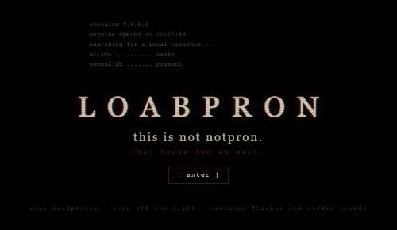
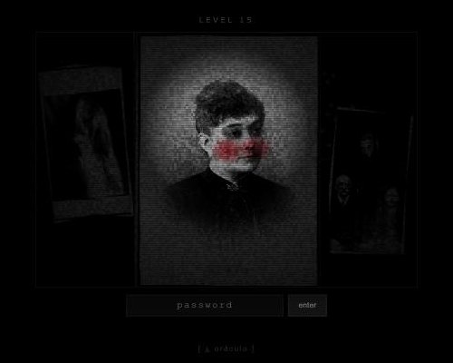
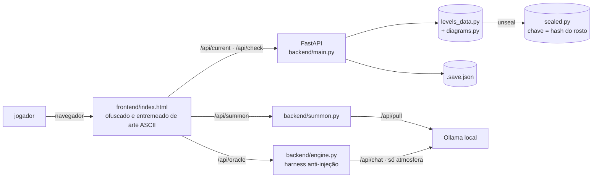

<div align="center">



# LoabPron

**isto não é o notpron. lá havia uma saída.**

Um web riddle de horror no espírito do *Notpron* (2004): uma imagem, um campo de senha e nenhuma ajuda.<br>
Trinta e uma fases feitas de fotos reais de domínio público, diagramas desenhados a tinta e coincidências macabras da história.<br>
Um oráculo assombrado, rodando **100% na sua máquina** com Gemma via Ollama, observa você jogar.

[Jogar](#jogar) · [Como funciona](#como-funciona) · [Desenvolvimento](#desenvolvimento) · [Fluxo agêntico](#fluxo-agêntico) · [Créditos](#créditos)


</div>

---

## Jogar

```bash
git clone https://github.com/lucasrafaldini/LoabPron.git
cd LoabPron
./play
```

É só isso. O `./play`:

1. prepara o Python (usa [`uv`](https://docs.astral.sh/uv) se existir; senão cria um `venv` e usa `pip`);
2. pergunta se pode instalar o [Ollama](https://ollama.com) caso ele não exista (Homebrew no macOS, script oficial no Linux);
3. acorda o `ollama serve` se ele estiver dormindo e o desliga quando você fugir;
4. abre o jogo no navegador.

Na **tela de abertura** o jogo verifica se o modelo já habita a máquina. Se não, oferece **invocar a entidade** — o download do Gemma (~1.6 GB) acontece dentro do próprio jogo, com barra de progresso, e só depois do seu clique. Você pode entrar enquanto ela atravessa o véu.

> **Windows:** `powershell -ExecutionPolicy Bypass -File .\play.ps1` (oferece `winget install Ollama.Ollama`).
>
> **Sem Ollama?** O jogo funciona do mesmo jeito. O oráculo apenas responde com ecos dos mestres mortos.

| Requisito | Necessário? | Observação |
|---|---|---|
| Python 3.11+ ou `uv` | sim | `uv` é instalado em segundos e dispensa Python no sistema |
| Ollama | recomendado | dá voz ao oráculo |
| Gemma (`gemma2:2b`) | recomendado | ~1.6 GB, baixado pela tela de abertura ou com `./play --pull` |
| Fones de ouvido | **sim** | o som é procedural e é metade do medo |

Seu progresso fica salvo em `.save.json` — feche, durma (se conseguir), volte depois.

**Português ou inglês:** a primeira tela pergunta em que língua a casa vai falar. Tudo se adapta: interface, sussurros, tabuleiro Ouija, o harness do Gemma e o veredito final. *The first screen asks which language the house should speak; everything follows.*

<details>
<summary>⚠️ Aviso de fotossensibilidade</summary>

O jogo contém flashes curtos (≤ 80 ms, nunca em sequência), sons súbitos e imagens perturbadoras. Com `prefers-reduced-motion` ativado no sistema, flashes, tremores e animações são desligados. O botão ♪ no canto inferior esquerdo silencia tudo.
</details>

---

## Como funciona

### Três vias para cada porta

Assim como no Notpron, não há dicas. Diferente dele, toda fase tem **três respostas**, e a casa percebe por qual caminho você entrou:

| Via | Quem é você | O que funciona |
|---|---|---|
| **bruta** | o arrombador de cifras | o que está escondido no código-fonte da página |
| **lenta** | o historiador das sombras | o que a imagem, as datas e as coordenadas contam a quem pesquisa |
| **esperta** | o manipulador da rede | o que trafega entre você e o servidor |

No final, depois do ritual, você descobre que tipo de peregrino foi.

### A casa observa



- **Montagens**: cada fase é uma colagem de fotografias e gravuras reais de domínio público (Goya, Piero della Francesca, fotografias espíritas de William Hope, arquivos de prisão, manuscritos em ge'ez…), com fita adesiva, molduras tortas e grão de filme.
- **Diagramas a tinta**: geometrias de eclipse, plantas de panóptico, sigilos, constelações, estratos de escavação, a molécula de um alcaloide — todos gerados em código e "desenhados" diante de você.
- **Escalada**: depois da metade, a tela escurece e só a lanterna do cursor ilumina a cena; um coração começa a bater e acelera a cada erro.
- **Tabuleiro Ouija**: o campo de senha é uma prancheta — alguém escreve nele quando você para, e às vezes completa o que você digitou. Um tabuleiro surge sobre a cena e a prancheta soletra. O mouse é tomado e escreve sozinho na tela antes de devolver o controle.
- **O espírito responde**: a cada erro e a cada porta aberta, o Gemma reage com uma frase curta, soletrada letra a letra — sob um harness que o impede de dar pistas ou de repetir o que você digitou.
- **Ela sabe quem você é**: o servidor roda na sua máquina e lê o nome da sua conta do sistema. O Gemma julga se é nome de gente: se for, a casa chama você por ele em sussurros, flashes, no tabuleiro e no código-fonte; se a conta for "casa", "familia" ou "escritorio", ela zomba de quem divide o computador ("todo mundo usa esse computador, né?"). Nada sai da máquina. Para jogar anônimo: `LOABPRON_ANONIMO=1 ./play`; para outro nome: `LOABPRON_NOME=Ana ./play`.
- **Ela**: um rosto de bochechas em carne viva e olhos vazios surge de relance nas bordas da tela, atravessa os flashes e espera no porão.
- **Presença**: sussurros ininteligíveis passam de um ouvido ao outro. Olhos se abrem no escuro das margens. Frames subliminares atravessam as transições. Troque de aba e o título implora para você voltar.
- **Nem tudo é senha**: algumas portas se abrem apontando um lugar no mapa-múndi; outras só se revelam a quem escuta.
- **O código-fonte também é assombrado**: a cada recarga o *view-source* abre com um presságio diferente (citações antigas ou uma frase escrita pelo Gemma), a casa conta quantas vezes você voltou e diz o seu nome. Quem inspeciona o DOM, a rede ou o console encontra mais do que esperava.
- **O veredito**: no fim, a casa mostra a proporção das três vias, tentativas, erros por porta, horas de madrugada e a porta que mais resistiu. O Gemma escolhe entre oito perfis (do Clarividente ao Insone) e escreve um veredito sobre você.
- **Sussurros**: errar nunca ajuda. Errar muito torna a voz pessoal — ela sabe que horas são aí.
- **Oráculo**: o *Espelho de Obsidiana* conversa no tom de Dee, Spare, Lévi, Crowley, Gurdjieff e do Mahābhārata. Ele não conhece nenhuma senha, resiste a prompt injection e sua saída é filtrada contra todas as respostas.

### Arquitetura



O frontend real vive em `frontend_src/` (JS ES5 e CSS sem dependências). `tools/build.py` minifica, cifra com XOR+base64 e intercala o resultado com arte ASCII e trechos do Mahābhārata — quem abre o *view-source* encontra um ritual, não um código.

---

## Desenvolvimento

```bash
uv sync                                  # ambiente completo (pytest, minificadores, pillow)
uv run pytest                            # 88 testes; não precisa de servidor nem de ollama
uv run python tools/build.py             # obrigatório após editar frontend_src/
uv run python run.py --no-browser        # servidor em http://127.0.0.1:8000
```

Atalhos: `make play`, `make build`, `make test`, `make images`, `make dev` (reload automático). Durante o desenvolvimento, `http://127.0.0.1:8000/#dev` pula a tela de abertura e expõe `window.__haunt` para disparar as assombrações.

### Configuração

| Variável | Padrão | Para quê |
|---|---|---|
| `LOABPRON_MODEL` | `gemma2:2b` | modelo do oráculo (ex.: `gemma3:1b`) |
| `OLLAMA_HOST` | `http://127.0.0.1:11434` | Ollama em outra porta ou máquina |
| `LOABPRON_PORT` | `8000` | porta inicial (procura a próxima livre) |
| `LOABPRON_SAVE` | `./.save.json` | arquivo de progresso |
| `LOABPRON_NOME` | nome da conta | como a casa chama o jogador |
| `LOABPRON_ANONIMO` | — | `1` impede a casa de procurar o nome |

### Estrutura

```
backend/
  main.py          API, estado e persistência
  levels_data.py   as 31 fases: cena, lore e diagramas (sem respostas)
  vault.py         o cofre: cifra as respostas com o hash de uma imagem do jogo
  sealed.py        respostas, cifras, headers, temas e créditos, lacrados
  diagrams.py      diagramas SVG gerados em código
  engine.py        oráculo, reações do espírito, harness anti-injeção, sussurros e ecos
  i18n.py          todos os textos do servidor em pt e en
  omens.py         presságio por recarga no view-source (citações + Gemma)
  profile.py       métricas da partida, 8 perfis e o veredito do Gemma
  witness.py       o nome do jogador, lido da conta local (opcional)
  summon.py        detecção do Ollama e download do modelo com progresso
  config.py        variáveis de ambiente
frontend_src/      fonte real do frontend (i18n.js, app.js, style.css)
frontend/          index.html gerado + img/ (nomes opacos)
tools/
  build.py         empacota e ofusca o frontend
  commons.py       busca e baixa imagens PD/CC0 do Wikimedia Commons
  seal.py          lacra secrets/ em backend/sealed.py (e --open para abrir)
  ascii_art.py     a arte que assombra o view-source
  aparicao.py      gera a aparição recorrente a partir de um retrato de domínio público
  gabarito.py      gera docs/GABARITO.csv (local, fora do git)
secrets/           fora do git: respostas, fontes das imagens e créditos em texto
tests/             campanha pelas 3 vias, persistência, invocação, auditoria de spoilers
.claude/           subagentes e skills para desenvolvimento agêntico
play · play.ps1    setup de um comando
```

### Regras de ouro

1. **Nenhuma senha aparece em texto visível** (legendas, diagramas, lore, arte ASCII). `tests/test_spoilers.py` falha se isso acontecer.
2. Cifras são **geradas por código** (`b64`, `hx`, `rot13`, `binr`), nunca digitadas.
3. O modelo **nunca recebe senhas** — só a atmosfera da fase.
4. Toda fase tem as **três vias**.
5. Imagens **só de domínio público ou CC0**, sempre via `tools/commons.py`, que registra a atribuição.

### Binário standalone

```bash
uv run --with pyinstaller pyinstaller --onefile \
  --add-data "frontend:frontend" --add-data "backend:backend" \
  --name LoabPron run.py
```

---

## Fluxo agêntico

O repositório foi preparado para ser desenvolvido por agentes de código. [`AGENTS.md`](AGENTS.md) é o guia universal (Claude Code, Codex, Cursor, Gemini CLI); [`CLAUDE.md`](CLAUDE.md) o importa e acrescenta o específico do Claude Code.

| Tipo | Nome | Faz |
|---|---|---|
| subagente | [`level-designer`](.claude/agents/level-designer.md) | cria e redesenha fases: tema, imagens, diagrama, três vias |
| subagente | [`dread-director`](.claude/agents/dread-director.md) | atmosfera, som procedural, efeitos e escalada do medo |
| subagente | [`spoiler-auditor`](.claude/agents/spoiler-auditor.md) | auditoria somente-leitura de vazamentos de senha |
| subagente | [`oracle-warden`](.claude/agents/oracle-warden.md) | testa e endurece o oráculo contra prompt injection |
| skill | [`new-level`](.claude/skills/new-level/SKILL.md) | passo a passo para uma fase nova, do Commons ao teste |
| skill | [`build-and-verify`](.claude/skills/build-and-verify/SKILL.md) | build, testes e inspeção visual no navegador |
| skill | [`summon-gemma`](.claude/skills/summon-gemma/SKILL.md) | instalar, diagnosticar e trocar o modelo |

Exemplos de pedidos para o agente:

```text
crie uma fase sobre o Triângulo das Bermudas, com fotos PD e um mapa náutico
faça uma auditoria de spoilers antes do commit
deixe a fase 9 mais claustrofóbica
teste o oráculo com gemma3:1b contra 20 tentativas de injeção
```

---

## Créditos

- **Notpron** (2004), de David Münnich — a primeira casa. Este projeto é uma homenagem, não uma cópia: nenhuma fase, imagem ou texto do Notpron é usado.
- Imagens: Wikimedia Commons, domínio público e CC0. Os títulos entregariam os temas, então a lista completa com autores e fontes aparece **no fim do jogo**, depois do ritual.
- Oráculo: [Gemma](https://ai.google.dev/gemma) via [Ollama](https://ollama.com).
- Criado para o desafio *Hacktoberfest Open-Source AI Challenge — Week 4: "Ghost in the Machine"* do DEV.to.

## Licença

[MIT](LICENSE). As imagens mantêm seu status original (domínio público / CC0).

### Por que não há respostas neste repositório

Um riddle de código aberto entrega o jogo a quem abrir `levels_data.py`. Aqui as respostas estão lacradas em `backend/sealed.py`, e a chave não está escrita em lugar nenhum: é derivada do hash de uma das imagens do próprio jogo. Não é segurança (o servidor precisa conferir as respostas, então quem ler o código pode refazer o caminho); é uma porta trancada com a chave escondida dentro da casa. Quem a encontrar terá jogado um nível a mais.

<div align="center"><sub>apague a luz.</sub></div>
